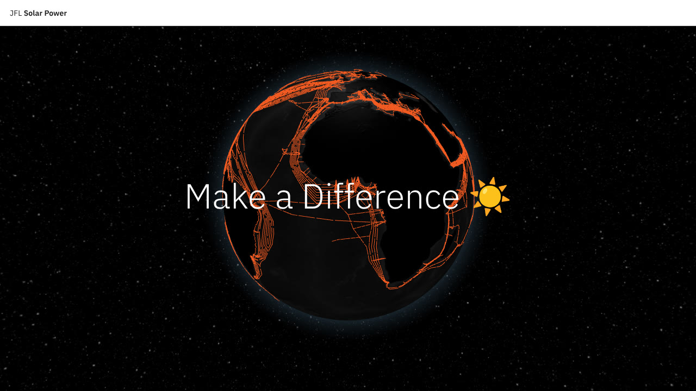
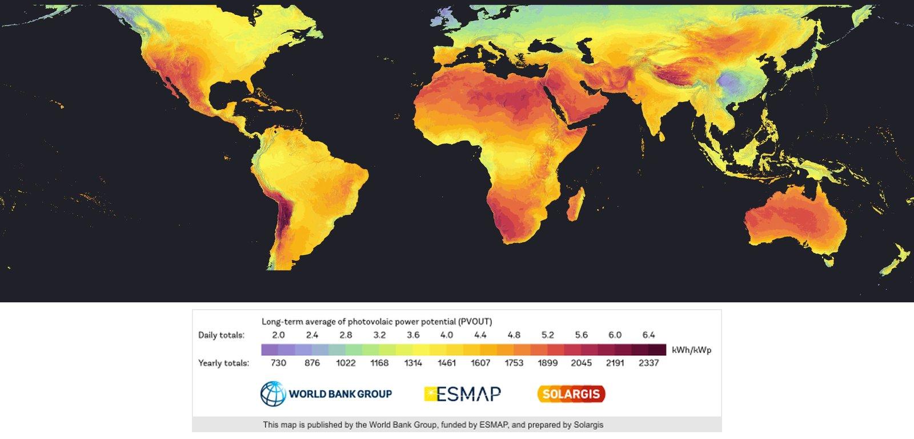
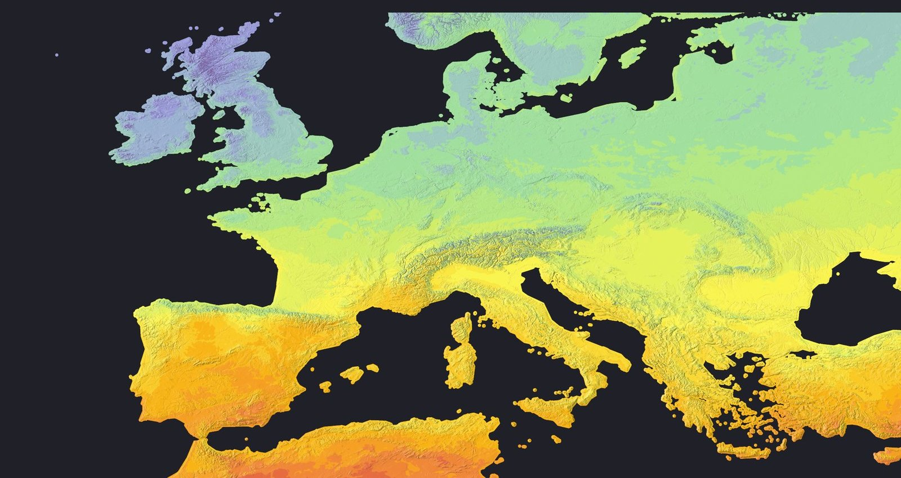

# Start_Hack_Jfl

**Solar Savings Map** (JFL Solar) is our START Hack 2023 project in St. Gallen. We were the top team in the Energy category of the Google track.

The app opens on a 3D globe built with three.js. You pick a spot on Google Maps, enter your roof area and panel coverage, and it pulls solar irradiance from NASA's POWER API to show daily and yearly output, yearly savings and lifetime net savings in EUR over 25 years.

The final version of the app is on the [`globe-integration` branch of naseweisssss/Start_Hack_Jfl](https://github.com/naseweisssss/Start_Hack_Jfl/tree/globe-integration). This fork has the earlier work, including the solar potential layer below.

## What's in here

- `jfl-solar/` is the web app (Next.js, React, TypeScript, Google Maps).
- `jfl-solar/public/files/` holds the solar potential layer: the Global Solar Atlas photovoltaic output (PVOUT) map cut into 28,000+ map tiles across zoom levels 0 to 8. Each tile is a PNG with a KML file giving its bounds.
- `jfl-solar/src/app/tariff.js` matches a location to its country via reverse geocoding, then looks up electricity prices per kWh for 30 countries.

The screenshots above are stitched from the tiles in `jfl-solar/public/files` (zoom 4 for the world, zoom 6 for Europe).

Solar data: [Global Solar Atlas](https://globalsolaratlas.info/), published by the World Bank Group, funded by ESMAP and prepared by Solargis.
